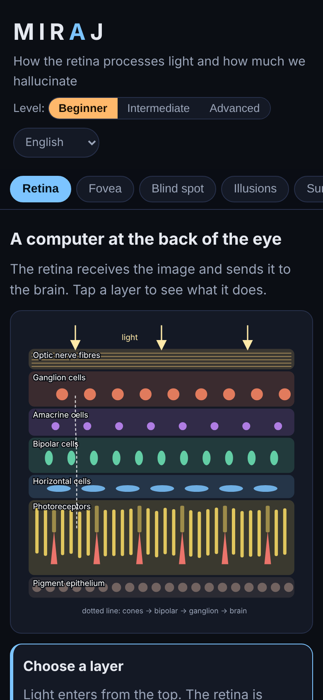
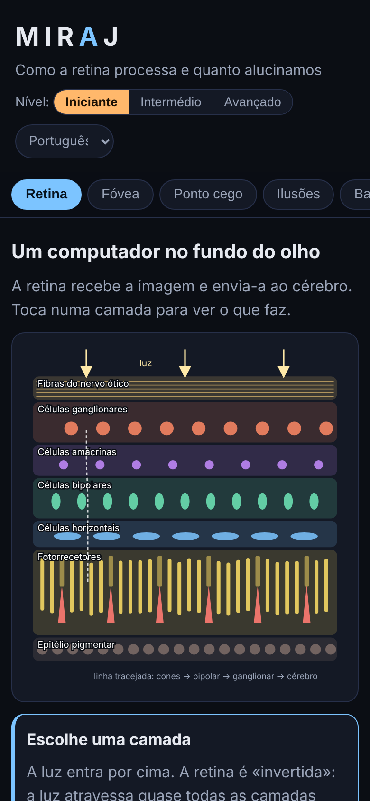

# MIRAJ

[English](README.md) · [Română](README.ro.md) · [Français](README.fr.md) · [Italiano](README.it.md) · **Español** · [Português](README.pt.md) · [Deutsch](README.de.md) · [Magyar](README.hu.md)

Cómo ve la retina y cómo construye el cerebro la imagen: explicación interactiva en tres niveles, en 8 idiomas.

**[Abrir la aplicación →](https://miraj.chiuta.ro/)**

_Versión: 1.2.1 · Última actualización: 2026-11-15_

| 1 | 2 | 3 |
|---|---|---|
|  |  |  |

## Capturas de pantalla

       

## Funciones

- Pestañas: retina, fóvea, punto ciego, ilusiones, resumen y un cuestionario de 10 preguntas.
- Tres niveles (principiante, intermedio, avanzado) para el mismo contenido.
- Demostraciones interactivas del punto ciego y la fóvea; selector de idioma (8 idiomas).

## Uso

Abre la página en línea, o descarga `index.html` y ábrelo en un navegador reciente. Sin instalación ni build.

## Límites

- Explicación educativa, no consejo médico ni examen de la vista.
- Interfaz en 8 idiomas (RO, EN, FR, DE, ES, IT, HU, PT), elegible en el selector de la aplicación; traducciones asistidas por máquina, no revisadas por hablantes nativos.

## Privacidad

Sin seguimiento, sin peticiones de red (CSP `connect-src none`), sin cuentas. Los datos permanecen en este navegador (localStorage) y se pueden borrar en cualquier momento.

## Licencia

MIT — véase [LICENSE](LICENSE).
