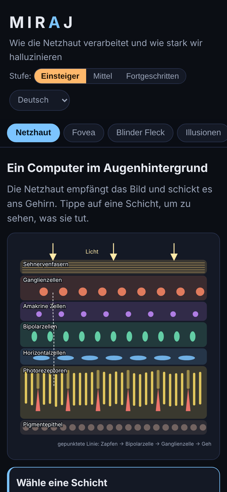
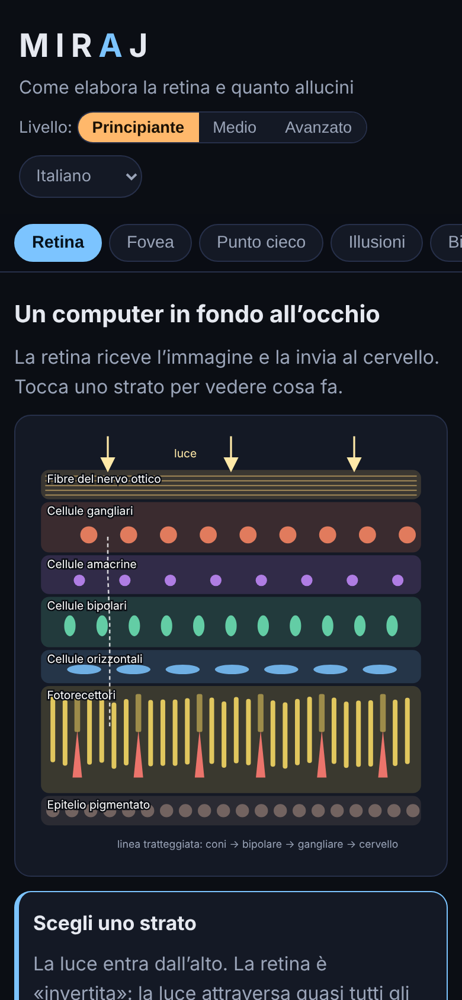

# MIRAJ

[English](README.md) · [Română](README.ro.md) · [Français](README.fr.md) · [Italiano](README.it.md) · [Español](README.es.md) · [Português](README.pt.md) · [Deutsch](README.de.md) · **Magyar**

Hogyan lát a recehártya, és hogyan építi fel az agy a képet: interaktív magyarázat három szinten, 8 nyelven.

**[Alkalmazás megnyitása →](https://miraj.chiuta.ro/)**

_Verzió: 1.2.2 · Utolsó frissítés: 2026-11-17_

| 1 | 2 | 3 |
|---|---|---|
|  |  |  |

## Képernyőképek

       

## Funkciók

- Fülek: recehártya, fovea, vakfolt, illúziók, összegzés és 10 kérdéses kvíz.
- Három szint (kezdő, haladó, szakértő) ugyanahhoz a tartalomhoz.
- Interaktív vakfolt- és fovea-bemutatók; nyelvválasztó (8 nyelv).

## Használat

Nyisd meg az oldalt online, vagy töltsd le az `index.html` fájlt és nyisd meg egy friss böngészőben. Telepítés és build nélkül.

## Korlátok

- Oktató jellegű magyarázat, nem orvosi tanács és nem látásvizsgálat.
- A felület 8 nyelven érhető el (RO, EN, FR, DE, ES, IT, HU, PT), az alkalmazás nyelvválasztójából; a fordítások gépi segítséggel készültek, anyanyelvi lektorálás nélkül.

## Adatvédelem

Nincs követés, nincs hálózati kérés (CSP `connect-src none`), nincs fiók. Az adatok ebben a böngészőben maradnak (localStorage), és bármikor törölhetők.

## Licenc

MIT — lásd [LICENSE](LICENSE).
