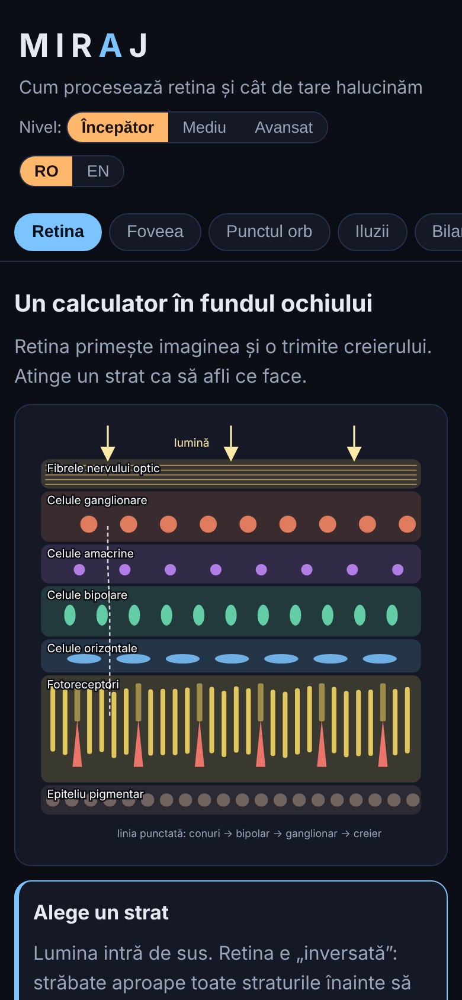

# MIRAJ

[English](README.md) · [Română](README.ro.md) · [Français](README.fr.md) · **Italiano** · [Español](README.es.md) · [Português](README.pt.md) · [Deutsch](README.de.md) · [Magyar](README.hu.md)

Come vede la retina e come il cervello costruisce l’immagine: spiegazione interattiva su tre livelli, in rumeno e inglese.

**[Apri l’app →](https://miraj.chiuta.ro/)**

_Versione: 1.0.0 · Ultimo aggiornamento: 2026-11-14_

| 1 | 2 | 3 |
|---|---|---|
|  |  |  |

## Funzioni

- Schede: retina, fovea, punto cieco, illusioni, riepilogo e quiz di 10 domande.
- Tre livelli (principiante, intermedio, avanzato) per lo stesso contenuto.
- Dimostrazioni interattive di punto cieco e fovea; cambio RO/EN.

## Utilizzo

Apri la pagina online, oppure scarica `index.html` e aprilo in un browser recente. Nessuna installazione né build.

## Limiti

- Spiegazione didattica, non un parere medico né un esame della vista.
- Interfaccia solo in rumeno e inglese.

## Privacy

Nessun tracciamento, nessuna richiesta di rete (CSP `connect-src none`), nessun account. I dati restano in questo browser (localStorage) e si possono cancellare in qualsiasi momento.

## Licenza

MIT — vedi [LICENSE](LICENSE).
