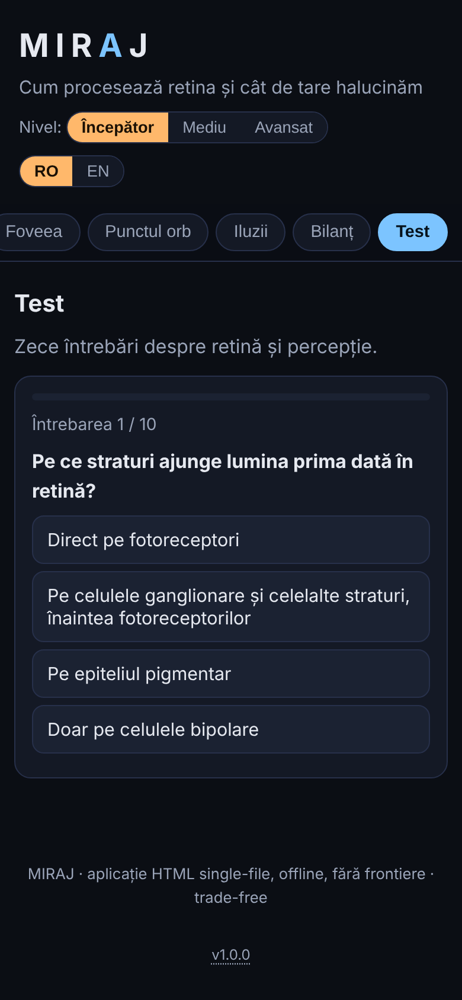

# MIRAJ

**English** · [Română](README.ro.md) · [Français](README.fr.md) · [Italiano](README.it.md) · [Español](README.es.md) · [Português](README.pt.md) · [Deutsch](README.de.md) · [Magyar](README.hu.md)

How the retina sees and how the brain builds the picture: an interactive explainer on three levels, in 8 languages.

**[Open the app →](https://miraj.chiuta.ro/)**

_Version: 1.2.2 · Last updated: 2026-11-17_

| 1 | 2 | 3 |
|---|---|---|
|  |  |  |

## Screenshots

       

## Features

- Tabs: retina, fovea, blind spot, illusions, summary and a 10-question quiz.
- Three levels (beginner, intermediate, advanced) for the same content.
- Interactive blind-spot and fovea demonstrations; language selector (8 languages).

## Usage

Open the page online, or download `index.html` and open it in a recent browser. No installation, no build.

## Limits

- Educational explainer, not medical advice or an eye test.
- Interface in 8 languages (RO, EN, FR, DE, ES, IT, HU, PT), chosen from the selector in the app; translations are machine-assisted and not reviewed by native speakers.

## Privacy

No tracking, no network requests (CSP `connect-src none`), no accounts. Data stays in this browser (localStorage) and can be erased at any time.

## License

MIT — see [LICENSE](LICENSE).
