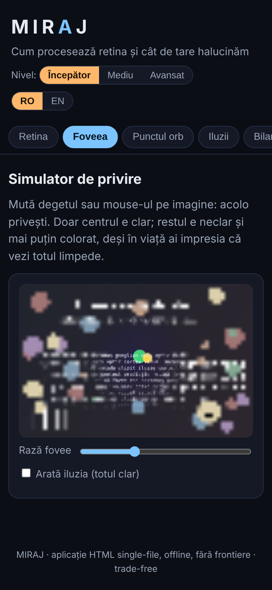

# MIRAJ

[English](README.md) · [Română](README.ro.md) · [Français](README.fr.md) · [Italiano](README.it.md) · [Español](README.es.md) · **Português** · [Deutsch](README.de.md) · [Magyar](README.hu.md)

Como a retina vê e como o cérebro constrói a imagem: explicação interativa em três níveis, em 8 idiomas.

**[Abrir a aplicação →](https://miraj.chiuta.ro/)**

_Versão: 1.2.3 · Última atualização: 2026-11-20_

| 1 | 2 | 3 |
|---|---|---|
|  |  |  |

## Capturas de ecrã

       

## Funcionalidades

- Separadores: retina, fóvea, ponto cego, ilusões, resumo e um questionário de 10 perguntas.
- Três níveis (iniciante, intermédio, avançado) para o mesmo conteúdo.
- Demonstrações interativas do ponto cego e da fóvea; seletor de idioma (8 idiomas).

## Utilização

Abre a página online, ou descarrega `index.html` e abre-o num navegador recente. Sem instalação nem build.

## Limites

- Explicação educativa, não é aconselhamento médico nem exame de visão.
- Interface em 8 idiomas (RO, EN, FR, DE, ES, IT, HU, PT), à escolha no seletor da aplicação; traduções assistidas por máquina, não revisadas por falantes nativos.

## Privacidade

Sem rastreamento, sem pedidos de rede (CSP `connect-src none`), sem contas. Os dados ficam neste navegador (localStorage) e podem ser apagados a qualquer momento.

## Licença

MIT — ver [LICENSE](LICENSE).
