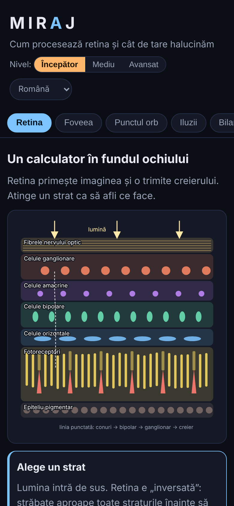
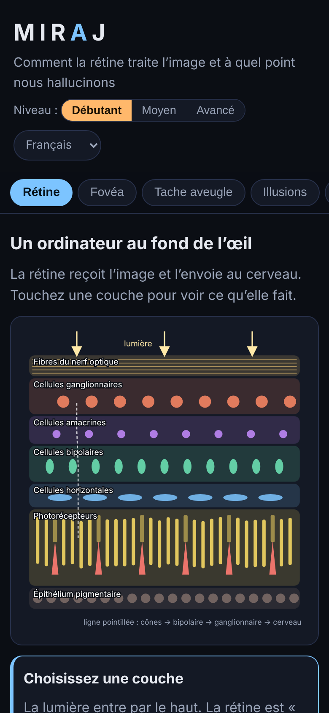
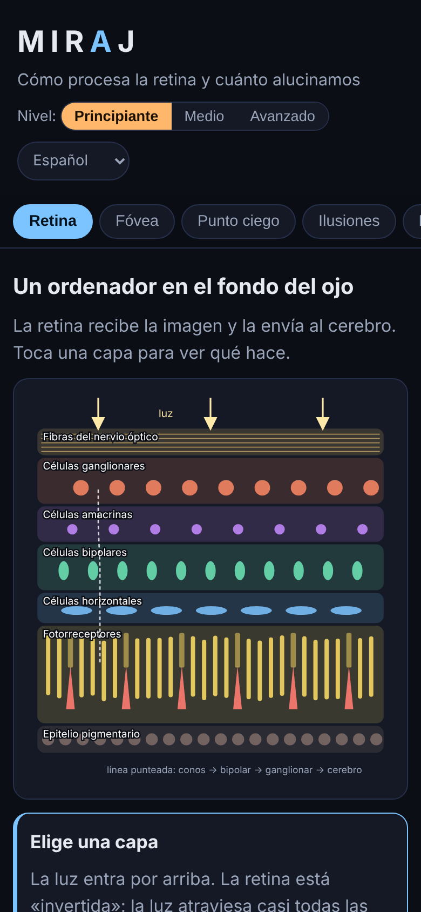
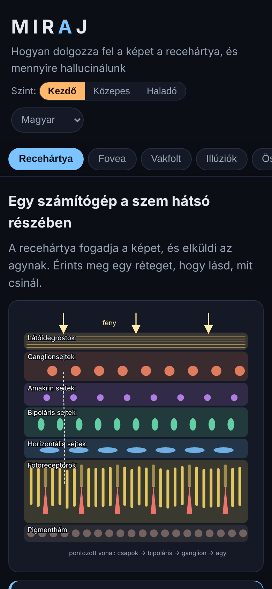

# MIRAJ

[English](README.md) · **Română** · [Français](README.fr.md) · [Italiano](README.it.md) · [Español](README.es.md) · [Português](README.pt.md) · [Deutsch](README.de.md) · [Magyar](README.hu.md)

Cum vede retina și cum construiește creierul imaginea: explicație interactivă pe trei niveluri, în 8 limbi.

**[Deschide aplicația →](https://miraj.chiuta.ro/)**

_Versiune: 1.0.0 · Ultima actualizare: 2026-11-14_

| 1 | 2 | 3 |
|---|---|---|
|  |  |  |

## Capturi de ecran

       

## Funcții

- File: retină, fovee, punct orb, iluzii, bilanț și un test cu 10 întrebări.
- Trei niveluri (începător, intermediar, avansat) pentru același conținut.
- Demonstrații interactive pentru punctul orb și fovee; selector de limbă (8 limbi).

## Utilizare

Deschide pagina online sau descarcă `index.html` și deschide-l într-un browser recent. Fără instalare, fără build.

## Limite

- Explicație educațională, nu sfat medical și nu test oftalmologic.
- Interfață în 8 limbi (RO, EN, FR, DE, ES, IT, HU, PT), aleasă din selectorul din aplicație; traducerile sunt asistate automat și nerevizuite de vorbitori nativi.

## Confidențialitate

Fără urmărire, fără cereri de rețea (CSP `connect-src none`), fără conturi. Datele rămân în acest browser (localStorage) și pot fi șterse oricând.

## Licență

MIT — vezi [LICENSE](LICENSE).
